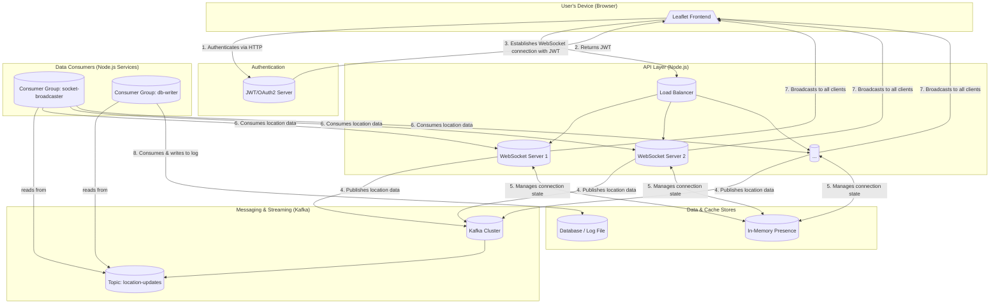

# Real-time Location Tracking System

This project is a real-time location tracking system built with Node.js, Express, Socket.IO, and Kafka. It demonstrates a scalable and resilient architecture for handling high-volume location data streams.

## Architecture

The system is designed with a decoupled, microservices-oriented architecture.



## Core Concepts

### Authentication Flow

1.  A user sends their credentials to a standard REST endpoint (`/auth/login`).
2.  The server validates the credentials and generates a JSON Web Token (JWT).
3.  The client stores this JWT.
4.  When establishing a WebSocket connection, the client sends the JWT in the initial handshake.
5.  A Socket.IO middleware on the server intercepts this handshake, verifies the JWT, and attaches the `userId` to the socket instance for future use. If the token is invalid, the connection is rejected.

### Socket Flow

1.  **Connection**: A client connects with a valid JWT. The server registers the user in a `presenceService`.
2.  **Presence**: The server sends the new user a list of all other currently connected users. It then notifies all other clients that a new user has joined.
3.  **Location Updates**: The client uses the browser's `navigator.geolocation` API to get its coordinates and emits a `locationUpdate` event to the server every 5 seconds.
4.  **Ingestion**: The server receives this update and immediately publishes it to the `location-updates` Kafka topic.
5.  **Disconnect**: When a client disconnects, the `presenceService` removes them and broadcasts a `userDisconnected` event so other clients can remove their marker from the map.
6.  **Stale Users**: A background process on the server checks for users who haven't sent an update in over 30 seconds and treats them as disconnected, broadcasting a `userDisconnected` event.

### Kafka Flow

1.  **Producer**: The main Node.js application acts as a Kafka producer. When it receives a location update via a socket, it serializes the data and sends it to the `location-updates` topic. This is a very fast, non-blocking operation.
2.  **Consumers**: Two independent consumer groups subscribe to the `location-updates` topic:
    *   **`socket-broadcaster`**: Its job is to consume messages in real-time and broadcast them to all connected WebSocket clients. This keeps the frontend maps updated.
    *   **`db-writer`**: Its job is to consume the same messages and persist them. In this project, it writes to a log file (`location-log.txt`), but in a production system, it would perform batch writes to a database (e.g., PostGIS or MongoDB).

### Why Use Kafka?

Using Kafka as an intermediary buffer between the initial data ingestion and the final processing provides several key advantages:

1.  **Decoupling**: The service that accepts location data is completely separate from the services that process it. If the database writer service crashes, the system can still accept new location data without interruption.
2.  **Scalability**: Kafka is built for extreme horizontal scalability. As traffic grows, you can add more Kafka brokers and more consumer instances to handle the load. Direct database writes often become a bottleneck in high-volume systems.
3.  **Performance**: Writing to a Kafka topic is an append-only log operation, which is significantly faster than a transactional database write. This keeps the user-facing API layer fast and responsive.
4.  **Flexibility (Stream Processing)**: The Kafka topic becomes a replayable source of truth. You can easily add new consumer applications in the future (for analytics, anomaly detection, etc.) without changing the existing application.

## Setup and Installation

1.  **Prerequisites**:
    *   Node.js (v14 or higher)
    *   npm
    *   A running Kafka instance. (For local development, you can use a Docker image like `bitnami/kafka`).

2.  **Clone the repository**:
    ```bash
    git clone <repository-url>
    cd <repository-directory>
    ```

3.  **Install dependencies**:
    ```bash
    npm install
    ```

4.  **Configure environment variables**:
    Create a `.env` file in the root of the project and add the following variables.

    **`.env` Example:**
    ```
    JWT_SECRET=your_super_secret_key_that_is_very_long_and_secure
    KAFKA_BROKERS=localhost:9092
    PORT=3000
    ```

5.  **Run the application**:
    ```bash
    npm start
    ```
    The server will start on the port specified in your `.env` file (defaulting to 3000).

## Demo

1.  **Start the server**: `npm start`

2.  **Get a JWT**: Use a tool like `curl` or Postman to get an authentication token.
    ```bash
    curl -X POST http://localhost:3000/auth/login \
    -H "Content-Type: application/json" \
    -d '{"username": "testuser", "password": "password"}'
    ```
    This will return a JSON object with an `accessToken`. Copy the token value.

3.  **Open the Frontend**: Open a web browser and navigate to `http://localhost:3000`.

4.  **Connect**: Paste the JWT into the input box and click "Connect".

5.  **Grant Permissions**: Your browser will ask for location permissions. Grant them.

6.  **Observe**:
    *   A **blue marker** will appear on the map at your current location.
    *   The server console will log the connection and location updates being published to Kafka.
    *   The `location-log.txt` file will be created/updated with the persisted location data from the `db-writer` consumer.
    *   To see the multi-user functionality, open a second browser tab/window, get another JWT (or use the same one), and connect. You will see a **red marker** appear on your first map representing the second user, and vice-versa.
